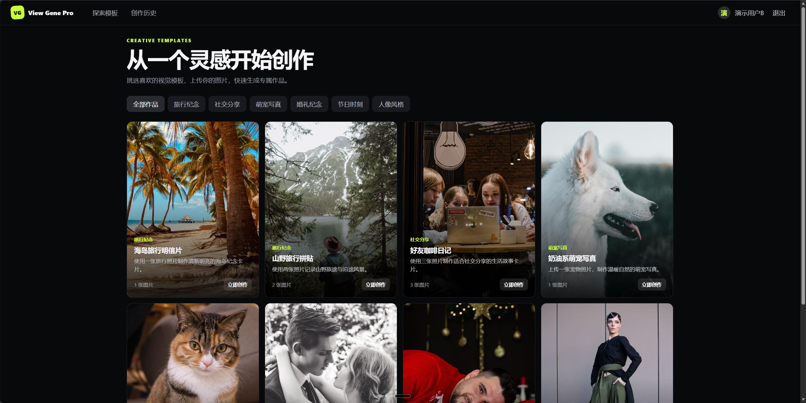
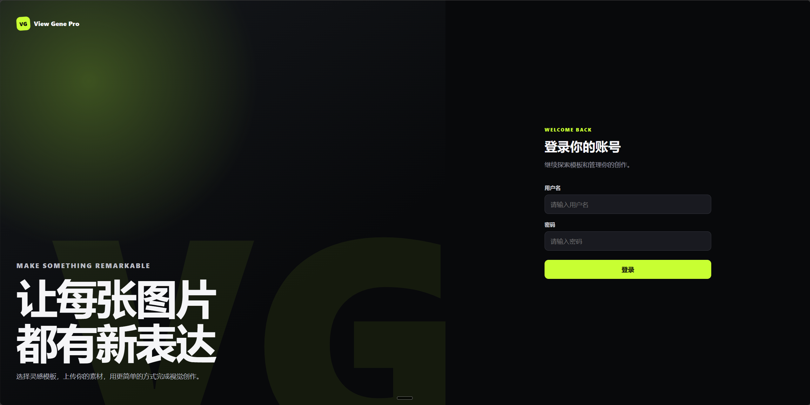
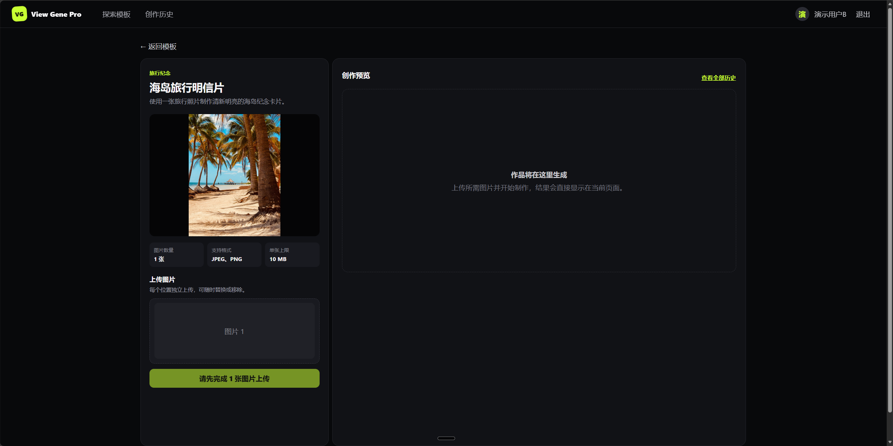
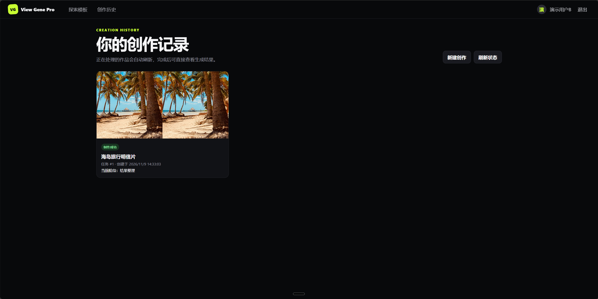

# View Gene Pro

一个可独立运行的图片素材制作网站。项目已经完成登录认证、模板浏览、图片上传、异步模拟制作、按用户隔离的任务历史、多任务自动轮询、刷新恢复、成功结果预览、关键自动化测试、GitHub Actions 和 Docker Compose 交付配置。



## 固定技术基线

| 项目 | 版本/约定 |
|---|---|
| Node.js | 24.x |
| npm | 11.x，使用 `package-lock.json` |
| Next.js | 16.4.5（App Router） |
| React | 19.2.0 |
| Java | 17 |
| Spring Boot | 3.5.7 |
| MyBatis Spring Boot Starter | 3.0.5 |
| MySQL | 8.x，本地端口 `3306` |
| 前端端口 | `3000` |
| 后端端口 | `8080` |

前端使用全局 CSS，不依赖组件库；服务端状态使用 TanStack Query 管理。Windows 本地开发使用 PowerShell，最终交付同时提供 Docker Compose 一键启动方式。

## 架构与职责

```text
Browser
  → Next.js App Router（页面、交互、上传状态、任务查询与轮询）
  → Java / Spring Boot API（认证、模板、素材、任务受理与后台执行）
  → MyBatis + MySQL（用户、模板、素材元数据、任务状态与历史）
  → 本地目录或 Docker 数据卷（上传文件）
```

Next.js 不承担业务执行或任务持久化。创建任务后，Java 在事务中写入任务记录并快速返回任务 ID，再由有界线程池依次执行素材检查、模拟生成和结果整理。查询接口只读取数据库状态，不驱动任务推进。

## 目录

```text
frontend/             Next.js 前端
backend/              Spring Boot 后端
nginx/                 Compose 同源反向代理
docs/                  技术方案、实施计划和素材来源
.github/workflows/     GitHub Actions
compose.yml            MySQL、后端、前端和 Nginx 编排
.env.example          环境变量清单
pom.xml               根 Maven 聚合入口（包含 backend）
```

## Windows 本地准备

需要 Node.js 24、npm 11、JDK 17、MySQL 8。先在 MySQL 中创建空库和开发账号（不要把真实密码提交到仓库）：

```sql
CREATE DATABASE view_gene CHARACTER SET utf8mb4 COLLATE utf8mb4_0900_ai_ci;
CREATE USER 'view_gene'@'localhost' IDENTIFIED BY 'your-local-password';
GRANT ALL PRIVILEGES ON view_gene.* TO 'view_gene'@'localhost';
```

在 PowerShell 中设置本次终端使用的配置：

```powershell
$env:DB_URL='jdbc:mysql://localhost:3306/view_gene?useUnicode=true&characterEncoding=utf8&serverTimezone=UTC&allowPublicKeyRetrieval=true&useSSL=false'
$env:DB_USERNAME='view_gene'
$env:DB_PASSWORD='your-local-password'
$env:JWT_SECRET='replace-with-at-least-32-random-characters'
$env:JWT_EXPIRATION_SECONDS='28800'
```

## 前端

```powershell
cd frontend
npm install
npm run lint
npm run type-check
npm test
npm run build
npm run dev
```

浏览 `http://localhost:3000`。API 基础地址默认是 `http://localhost:8080/api/v1`，可用 `NEXT_PUBLIC_API_BASE_URL` 覆盖。

## 后端

```powershell
cd backend
.\mvnw.cmd test
.\mvnw.cmd package
.\mvnw.cmd spring-boot:run
```

访问 `http://localhost:8080/actuator/health` 检查健康状态。应用启动时会连接 MySQL，并由 Flyway 自动执行尚未应用的迁移。

### 数据库初始化

首次连接空的 `view_gene` 数据库时，Flyway 会创建六张核心表并写入两个演示用户、六个分类和八个模板。模板包含 1、2、3 张图片等不同素材数量要求。演示用户为 `demo_user`、`demo_user_b`，开发演示密码均为 `demo123`。后端启动后可在 `http://localhost:3000/login` 登录。

### 接口

认证接口：

- `POST /api/v1/auth/login`：用户名和密码登录。
- `GET /api/v1/auth/me`：携带 `Authorization: Bearer <token>` 恢复当前用户。
- `POST /api/v1/auth/logout`：返回 204，由前端清除令牌和用户级查询缓存。

模板接口：

- `GET /api/v1/templates`：读取启用分类和模板，可用 `categoryCode` 筛选。
- `GET /api/v1/templates/{templateId}`：读取模板图片数量、格式和大小要求。

模板读取接口及 `/images/**` 演示资源公开访问；模板页面仍要求用户先登录。模板数据来自 MySQL，修改数据库中的启用模板后无需改动前端代码。

素材接口：

- `POST /api/v1/assets`：使用 `multipart/form-data` 上传 `templateId` 和 `file`。
- `GET /api/v1/assets/{assetId}/content`：仅允许素材所属用户读取图片内容。

上传文件默认保存在后端运行目录的 `uploads` 文件夹，可通过 `UPLOAD_DIR` 指定绝对目录。服务端根据文件头识别 JPG/PNG，不信任扩展名或浏览器声明的类型；存储名使用 UUID，数据库写入失败时会删除已经落盘的文件。

任务接口：

- `POST /api/v1/tasks`：按前端槽位顺序提交 `templateId` 和 `assetIds`，事务写入任务及素材关联。
- `GET /api/v1/tasks`：查询当前登录用户的任务，可使用 `status` 参数筛选。
- `GET /api/v1/tasks/{taskId}`：查询当前登录用户的单个任务。

主要请求字段：

```json
{
  "templateId": "travel-collage",
  "assetIds": [101, 102]
}
```

创建成功后返回任务 ID；任务查询主要返回模板摘要、`status`、`stage`、`resultUrl`、失败信息和创建/开始/完成/更新时间。任务状态为 `QUEUED`、`PROCESSING`、`SUCCEEDED`、`FAILED`；处理阶段为 `MATERIAL_CHECK`、`GENERATING`、`FINALIZING`。

创建任务时会再次校验模板要求、素材数量和重复项，并确认素材属于当前用户、状态和文件均有效。任务事务提交后，后台有界线程池依次执行 `MATERIAL_CHECK → GENERATING → FINALIZING`；每次状态变化使用独立短事务，创建接口不会等待模拟制作完成，也暂不承诺严格幂等。线程池拒绝任务时会把已创建记录补偿为 `FAILED / TASK_QUEUE_FULL`，接口返回 503 和 `taskId`。

### 模拟成功、失败和耗时

默认执行时间分别为 1 秒、3 秒和 1 秒。可在启动后端前通过 PowerShell 调整，单阶段范围为 0～60000 毫秒：

```powershell
$env:SIMULATION_MATERIAL_CHECK_DELAY_MS='1000'
$env:SIMULATION_GENERATING_DELAY_MS='3000'
$env:SIMULATION_FINALIZING_DELAY_MS='1000'
$env:SIMULATION_FAILURE_STAGE='NONE'
```

`SIMULATION_FAILURE_STAGE` 支持 `NONE`、`MATERIAL_CHECK`、`GENERATING`、`FINALIZING`。例如设置为 `GENERATING` 后，新建任务会稳定地在模拟生成阶段失败；改回 `NONE` 后恢复成功路径。配置在后端启动时读取，修改环境变量后需要重启后端。

### 我的制作与状态恢复

`/tasks` 按创建时间倒序展示当前用户的任务。只要存在 `QUEUED` 或 `PROCESSING` 任务，页面每 2.5 秒获取一次最新列表；全部进入 `SUCCEEDED` 或 `FAILED` 后自动停止轮询。刷新浏览器会重新从后端恢复历史和未完成任务。

查询暂时失败时，页面保留上一次成功获取的任务数据并显示查询警告，查询错误不会被当成任务业务失败。退出登录会取消请求并清空查询缓存；任务查询键包含用户 ID，旧用户的迟到响应不会写入新用户页面。成功任务直接展示模拟结果图片，并可在新窗口查看。

JWT 当前只提供 8 小时访问令牌，不提供刷新令牌或服务端撤销列表。因此退出登录只会清除本地令牌，已签发令牌在过期前理论上仍可使用；生产环境应评估 HttpOnly Secure Cookie/BFF、令牌撤销和更严格的密钥管理。

### 用户身份与个人记录

用户使用用户名和密码登录，后端校验 BCrypt 密码哈希并签发 JWT。前端通过 `Authorization: Bearer <token>` 调用受保护接口，并使用 `/auth/me` 恢复当前用户。

素材和任务记录均保存所属用户 ID。后端查询、素材读取和任务创建都会按认证用户校验归属关系，因此用户不能读取其他用户的素材或任务，也不能使用其他用户的素材 ID 创建任务。前端任务查询键包含用户 ID，退出登录时取消请求并清理缓存。

隔离演示方法：先使用 `demo_user / demo123` 上传图片并创建任务，退出后使用 `demo_user_b / demo123` 登录；第二个账号不应看到第一个账号的素材和任务。重新登录第一个账号后，其历史记录仍可恢复。

如需显式运行本机 MySQL 集成测试，请先在当前 PowerShell 设置数据库环境变量，再执行：

```powershell
$env:RUN_MYSQL_INTEGRATION_TESTS='true'
.\mvnw.cmd '-Dtest=DatabaseFoundationIntegrationTest' test
```

## 配置约定

完整键清单见 [`.env.example`](./.env.example)。Spring Boot 支持环境变量覆盖数据库、JWT、上传目录及模拟任务配置。仓库只包含开发默认值和占位密钥，不包含真实凭据。

## Docker Compose 一键启动

已安装 Docker 和 Docker Compose v2 时，在仓库根目录执行：

```powershell
docker compose up --build
```

Linux 服务器推荐使用后台方式启动：

```bash
git clone https://github.com/xxsxss-star/view_gene_pro.git
cd view_gene_pro
cp .env.example .env
docker compose --progress plain up --build -d
docker compose ps
```

部署完成后通过 Nginx 的 80 端口访问。例如服务器地址为 `192.168.35.138` 时，登录页为 `http://192.168.35.138/login`，不需要访问前端容器的 3000 端口。

MySQL 健康检查通过后，Compose 会依次启动后端、前端和 Nginx 网关。访问 `http://localhost`，使用 `demo_user / demo123` 或 `demo_user_b / demo123` 登录。后端健康检查统一通过 Nginx 入口 `http://localhost/actuator/health` 访问。

Compose 构建时默认将前端 API 地址设置为相对路径 `/api/v1`。Nginx 将 `/api/**`、`/images/**` 和 `/actuator/**` 转发到后端，其余请求转发到前端，因此浏览器始终使用同一域名和端口访问页面与 API，无需硬编码服务器 IP，也不会产生跨域请求。开发环境直接运行前后端时仍可通过 `NEXT_PUBLIC_API_BASE_URL` 指定后端地址。

默认从 Docker Hub 拉取基础镜像。如果部署服务器无法访问 Docker Hub，可在服务器根目录 `.env` 中设置镜像代理前缀，例如 `DOCKER_REGISTRY=docker.1ms.run/`。该变量同时作用于 MySQL、Nginx、Node.js 和 Java 基础镜像；GitHub Actions 未设置时仍使用 Docker Hub。不同代理对不同镜像的速度可能有差异，首次构建耗时较长时可再次执行相同命令复用 BuildKit 缓存。

前端 Docker 镜像构建时使用 `https://registry.npmmirror.com` 安装依赖，并关闭不影响交付的 audit 和 fund 请求，以减少国内服务器执行 `npm ci` 时的网络失败。后端 Docker 镜像构建使用仓库内的阿里云 Maven 镜像配置。

常用检查命令：

```bash
docker compose ps
docker compose logs -f backend
curl http://localhost/actuator/health
```

数据库文件和上传素材分别保存在 `mysql-data`、`uploaded-assets` 命名卷中，普通停止和重启不会丢失：

```powershell
docker compose down
docker compose up --build -d
docker compose ps
docker compose logs -f
```

需要重置全部演示数据时才执行 `docker compose down -v`；该命令会删除数据库和上传文件。可通过根目录 `.env` 覆盖 `COMPOSE_DB_PASSWORD`、`COMPOSE_MYSQL_ROOT_PASSWORD`、`COMPOSE_JWT_SECRET` 及模拟阶段配置，交付仓库不应包含真实凭据。

## 部署与回滚

首次部署或更新代码后，在仓库根目录执行：

```bash
cp .env.example .env
docker compose up --build -d
docker compose ps
curl --fail http://localhost/actuator/health
```

部署前应使用 `git rev-parse HEAD` 记录当前已验证版本。应用代码需要回滚时，切换到之前已验证的提交并重新构建：

```bash
git checkout <previous-verified-commit>
docker compose up --build -d
docker compose ps
```

普通 `docker compose down` 不会删除命名卷。Flyway 迁移仅向前执行，本项目没有自动数据库降级脚本；如果后续版本引入不兼容数据库迁移，应先备份数据库并采用向前修复迁移，不能仅依靠切换旧代码回滚数据库结构。`docker compose down -v` 会删除 MySQL 和上传文件，只能用于重置演示环境。

## 推荐演示流程

1. 执行 `docker compose up --build`，访问 `http://localhost/login`。

   

2. 使用 `demo_user / demo123` 登录，浏览分类并进入一个需要多张图片的模板。

   

3. 选择图片，验证预览、替换、移除、格式和大小提示，再提交制作任务。

   

4. 进入“创作历史”，观察 `MATERIAL_CHECK → GENERATING → FINALIZING` 和成功结果。

   

5. 连续创建多个任务，确认状态互不串扰；在处理中刷新页面，确认历史和轮询恢复。

6. 将 `SIMULATION_FAILURE_STAGE` 分别设置为 `MATERIAL_CHECK`、`GENERATING`、`FINALIZING`，每次重启后端并创建新任务，确认在指定阶段失败且不执行后续步骤。

7. 临时阻断浏览器对 `/api/v1/tasks` 的请求，确认保留旧任务并显示查询警告；解除阻断后恢复真实状态。

8. 等待全部任务终止，确认页面停止自动轮询。

9. 改用 `demo_user_b / demo123` 登录，确认看不到第一个用户的任务。

10. 运行下文的自动化检查命令。

## 持续集成

GitHub Actions 工作流位于 [`.github/workflows/ci.yml`](./.github/workflows/ci.yml)，在每次 push 和 pull request 时自动执行：

- 前端依赖安装、ESLint、TypeScript 类型检查、Vitest 测试和 Next.js 构建；
- 后端 Java 17 环境下的 Maven 测试与构建；
- 使用临时 MySQL 8.4 服务执行 Flyway、种子数据和 MyBatis 集成测试。
- 校验并构建 Compose 镜像，实际启动三个服务后检查前端首页和后端健康接口。

## 已完成、未完成与已知限制

已完成：

- 工程入口、Flyway 数据库结构和种子数据；
- 登录认证、用户隔离、模板分类与详情；
- 图片选择、预览、替换、移除、上传和前后端校验；
- 任务受理、查询、三阶段异步执行、可控失败和耗时；
- 多任务展示、查询异常区分、刷新恢复、终态保护和轮询清理；
- 关键前后端测试、GitHub Actions、Dockerfile、Compose 和 Nginx 同源代理。

未实现或有意不做：

- 不调用真实 AI 服务，结果由模拟生成器和本地示例图提供；
- 不提供模板管理后台、下载、删除、重新制作或视频处理；
- 不提供任务自动重试、严格幂等、断点续跑和消息队列；
- 不提供刷新令牌、服务端 JWT 撤销列表或第三方登录；
- 不提供对象存储和多实例文件共享。

已知限制：

- 后台任务运行在单个 Java 进程的有界线程池中。服务重启后，数据库中的任务和历史记录仍存在，但重启前未完成的任务不会自动恢复执行，可能停留在 `QUEUED` 或 `PROCESSING`；本项目未实现启动扫描、重新入队或人工恢复接口。
- 模拟耗时和失败阶段在后端启动时读取，修改配置后需要重启后端，只影响重启后新建任务。
- JWT 退出登录只清除浏览器本地令牌，已签发令牌在过期前仍可能使用。
- 上传文件使用本地目录或单机 Docker 数据卷，不支持多实例共享。
- 创建任务接口暂不承诺严格幂等。
- 生产环境仍需补充 HTTPS、正式域名、密钥管理、数据库/文件备份、监控告警和自动化回滚。

## 实际投入与取舍

> **实际投入约 _24_ 小时。**

投入主要用于需求拆解、数据库与接口设计、Java 多步骤异步任务、前端上传和任务状态管理、自动化测试、容器化及交付文档。项目优先保证题目要求的完整业务闭环和可解释性，没有为了增加技术复杂度引入 Redis、消息队列、SSE/WebSocket 或真实 AI 服务。

## AI 使用说明

> **具体与AI交互的文档放在.\docs\ai-generated**

本项目使用 AI 编程工具辅助需求拆解、代码实现、测试补充、错误定位和交付检查。AI 生成或修改的内容仍通过源码审查、编译、自动化测试或实际构建进行验证。

工作流如下：

1. 通过AI辅助进行需求理解和需求细节确认；
2. 通过AI完成技术方案的编写，接着人工确认进行方案取舍；
3. 通过AI进行方案的拆分，拆分成几个实现阶段；
4. 每个阶段向 AI 提供原题约束、现有目录、相关源码、接口边界和验收条件，避免脱离当前实现生成整套项目。
5. 让 AI 对局部文件提出或实施修改，再检查差异，保留与题目范围一致的部分。
6. 运行 ESLint、TypeScript、Vitest、Maven、MySQL 集成测试和生产构建；根据真实错误继续修正。
5. 最后重新对照原题，区分“源码已实现”“自动化已验证”和“尚待人工确认”。

## 脚手架、依赖与素材来源

- 前端基于 Next.js App Router，后端基于 Spring Boot，并使用 MyBatis、Flyway、TanStack Query、Vitest 等开源依赖；主要复用范围是框架能力和基础设施，没有复用现成业务项目代码。
- 模板照片来自 Unsplash、Pexels 和 Pixabay，仅用于开发、演示与作品集展示；具体文件、作者、来源页面和许可见 [`docs/ASSET_SOURCES.md`](./docs/ASSET_SOURCES.md)。
- SVG 模板封面和模拟结果图为项目自制素材，位于 `backend/src/main/resources/static/images/`。

## 最终交付标识

- 仓库地址：<https://github.com/xxsxss-star/view_gene_pro>
- **最终验收 commit：`67e89733ce90085d467b02cd7f8aecb9d6b77679`**
- **GitHub Actions 最终运行链接：`https://github.com/xxsxss-star/view_gene_pro/actions/runs/42741166590`**
